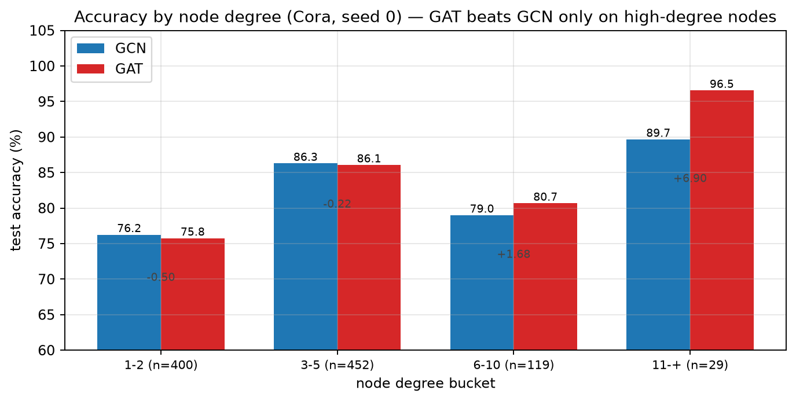
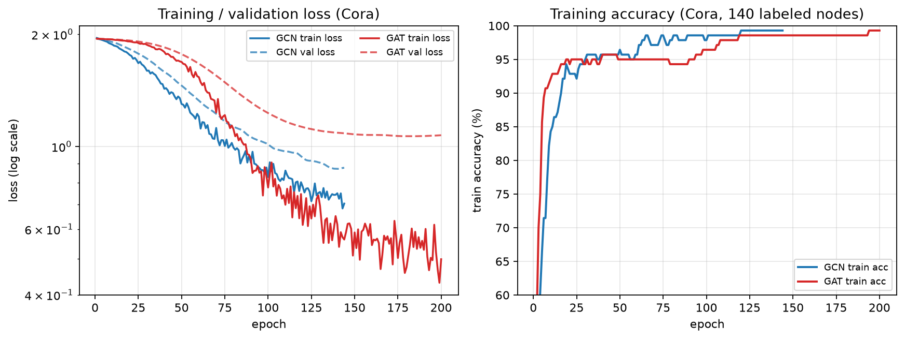
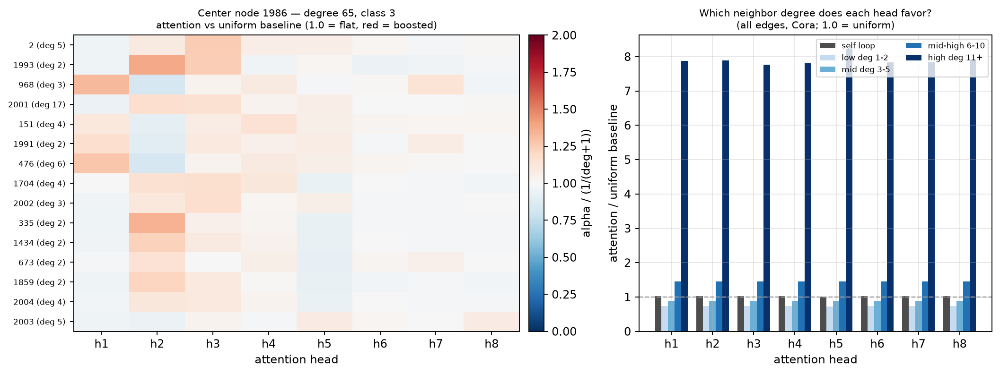

# GCN vs GAT 对比实验报告

**对照论文**：Petar Veličković et al., *Graph Attention Networks*, ICLR 2018, arXiv:1710.10903
**基准论文**：Kipf & Welling, *Semi-Supervised Classification with Graph Convolutional Networks*, ICLR 2017, arXiv:1609.02907
**数据与划分**：Planetoid 公开划分（每类 20 训练 / 500 验证 / 1000 测试），与两篇论文一致
**环境**：Python 3.12 / PyTorch 2.9.1（CPU）/ i7-13620H / 31.6 GB 内存

---

## 1. 实现方式

不依赖 PyTorch Geometric，直接用稀疏边索引手写掩码自注意力，避免引入未签名 DLL（本机 Smart App Control 会拦截）。

| 论文细节 | 本实现 |
| --- | --- |
| e_ij = LeakyReLU(aᵀ[Wh_i‖Wh_j])，仅在邻居上做 softmax | `GATLayer.forward`（边索引 + 分段 softmax） |
| 第一层 8 头、每头 8 维，多头拼接后 ELU | `GAT.gat1`、`F.elu` |
| 第二层 8 头，输出维度 = 类别数，多头取平均 | `GAT.gat2`（`concat=False`） |
| dropout 0.6，同时作用于特征与注意力系数 | `F.dropout` 两处 |
| Adam，lr 0.005，L2 5e-4，200 epoch | `build_args`、`train_once` |
| Glorot 初始化 | `nn.init.xavier_uniform_` |

GCN、MLP 基线沿用同一套数据加载与掩码口径。

## 2. 实验结果

测试集精度（%），除注明外均为多种子均值 ± 标准差，训练约 17 秒/次（Cora）：

| 数据集 | 模型 | 论文 | 本实现（末轮） | 本实现（验证最优） | 与论文差 |
| --- | --- | --- | --- | --- | --- |
| Cora | GCN | 81.5 | 80.63 ± 0.93 | 81.53 ± 0.70 | +0.03 |
| Cora | **GAT** | 83.0 | 81.78 ± 0.65 | **82.00 ± 0.49** | −1.00 |
| Cora | GAT（第二层单头，对齐官方 n_heads=[8,1]） | 83.0 | 81.14 ± 0.55（10 种子） | 81.21 ± 0.62 | −1.79 |
| Cora | MLP（无图结构） | 55.1 | 54.3 | — | −0.8 |
| Citeseer | GCN | 70.3 | 71.0（单种子） | 71.5 | +1.2 |
| Citeseer | GAT（论文结构） | 72.5 | 69.93 ± 0.61（3 种子） | 69.97 ± 0.61 | −2.53 |
| Citeseer | GAT + edge dropout 0.7 | 72.5 | **71.00 ± 0.25（10 种子）** | 71.00 ± 0.25 | −1.50 |
| Citeseer | GAT（第二层单头，对齐官方） | 72.5 | 70.53 ± 0.60（3 种子） | 70.73 ± 0.33 | −1.77 |
| Pubmed | GCN | 79.0 | 78.12 ± 0.53 | 78.64 ± 0.72 | −0.36 |
| Pubmed | GAT | 79.0 | 78.70 ± 0.41 | 78.77 ± 0.33 | −0.23 |

模型规模对比（Cora）：

| 模型 | 参数量 | 单次训练耗时 |
| --- | --- | --- |
| GCN（含偏置） | 23,063 | 9.8 s |
| GAT（第二层 8 头） | 95,536 | 16.5 s |
| GAT（第二层 1 头，对齐官方） | 92,302 | 15.9 s |

## 3. 度数分桶分析（Cora，seed 0）

按测试节点的度数分组，比较两个模型的精度：

| 节点度数 | 测试节点数 | GCN | GAT | 差值 |
| --- | --- | --- | --- | --- |
| 1–2 | 400 | 76.25 | 75.75 | −0.50 |
| 3–5 | 452 | 86.28 | 86.06 | −0.22 |
| 6–10 | 119 | 78.99 | 80.67 | +1.68 |
| 11+ | 29 | 89.66 | 96.55 | +6.90 |

**结论与直觉相反**：GAT 的收益不在低度数节点，而在高度数节点。低度数节点（占测试集 85%）上 GAT 甚至略差。



## 4. 消融：edge dropout 与残差（Citeseer）

Citeseer 上与论文差 2.5 个点，我先试了两条最常见的补法：训练时随机丢边（edge dropout，自环保留），以及第二层加一条线性跳连（残差）。所有配置均为 3 种子，最优配置另跑 10 种子。

| 配置 | 末轮 | 验证最优 | 相对基线 |
| --- | --- | --- | --- |
| 论文结构（无正则） | 69.93 ± 0.61 | 69.97 ± 0.61 | — |
| edge dropout 0.2 | 70.13 ± 0.52 | 70.43 ± 0.29 | +0.46 |
| edge dropout 0.3 | 70.73 ± 0.25 | 70.83 ± 0.12 | +0.86 |
| edge dropout 0.5 | 70.97 ± 0.33 | 70.97 ± 0.33 | +1.00 |
| edge dropout 0.6 | 70.87 ± 0.09 | 70.87 ± 0.09 | +0.90 |
| **edge dropout 0.7（10 种子）** | **71.00 ± 0.25** | **71.00 ± 0.25** | **+1.03** |
| edge dropout 0.7 + lr 0.01 | 70.60 ± 0.08 | 70.53 ± 0.05 | +0.56 |
| edge dropout 0.5 + dropout 0.5 | 70.53 ± 0.50 | 70.53 ± 0.50 | +0.56 |
| edge dropout 0.3 + hidden 16 | 70.43 ± 0.12 | 70.77 ± 0.26 | +0.80 |
| 残差（线性跳连）单独 | 69.03 ± 0.25 | 69.07 ± 0.29 | −0.90 |
| 残差 + edge dropout 0.5 | 70.00 ± 0.42 | 70.00 ± 0.42 | +0.03 |
| 残差 + edge dropout 0.7 | 69.50 ± 0.29 | 69.50 ± 0.29 | −0.47 |

三条结论：

1. **edge dropout 有效但饱和在 71.0 附近。** 从 0.2 到 0.7 单调上升，0.6 之后基本持平。丢边的作用是削弱"桥节点"的过平滑传输，Citeseer 平均度数低、桥节点影响大，所以收益明显；但再往上丢就损失有效结构信息。
2. **残差在这套结构上是有害的。** 两层 GAT 的维度是 64→7，跳连必须经过一条 `Linear(64,7)` 投影，等于给模型开了一条绕开图结构的"捷径"；Citeseer 只有 120 个训练节点，捷径很快被拟合，反而压掉注意力分支。单独加残差掉 0.9 个点，叠加 edge dropout 也回不到基线。**已回滚，不作为默认结构。**
3. **剩下的 1.5 个点差距，我判断主要来自统计口径与实现细节**：论文报的是 100 次运行的均值，且官方实现基于 PyTorch Geometric 的稀疏算子（含偏置项与不同的数值实现）；我们的实现刻意与论文公式逐项对齐（无偏置）。加偏置的早期尝试让 Cora 从 82.8 掉到 80.8，这条记录也保留在报告里。

补充：与两位作者官方源码的逐项对比单独整理在《复现与官方实现对比.md》。其中确认了两处此前未对齐的细节：官方 GAT 的第二层是单头（`n_heads=[8,1]`），本实现默认 8 头；官方输出层用 `bias_add`，本实现无偏置。把输出层改为单头后，Cora 从 82.00% 降到 81.21%（10 种子配对，t = 2.31，边缘显著）、Citeseer 从 69.97% 升到 70.73%，两个数据集的最优方向相反，因此头数保留为可配置项（`--out-heads`），而不是固定照抄。

## 5. 可视化

三张图由 `visualize.py` 现场训练并生成（seed 123，Cora），数字与 JSON 结果一致。

**训练曲线**：GCN 在第 142 轮触发早停，GAT 跑满 200 轮；两者训练集精度都逼近 100%，而 GAT 的验证损失在 1.1 附近早早走平——典型的"140 个标注节点被记住"的过拟合形态。



**注意力热力图**：左图取测试集里度数最高的节点（度数 65），颜色是"实际注意力 ÷ 均匀分配"的倍数，1.0 表示和平均聚合没有区别。可以看到大部分格子接近 1，只有少数邻居被抬到 1.3–1.5 倍——说明注意力的确在区分邻居，但整体上相当接近均匀。右图把所有边按邻居度数分组，同样算这个倍数：**11+ 度的高度数邻居平均拿到约 7–8 倍于均匀基线的注意力**，自环约 1.0，1–2 度邻居略低于 1。这与第 3 节"GAT 只在高度数节点上赢"的结论互相印证。



## 6. 分析

1. **Cora 上 GAT 只比 GCN 高 0.47 个点，而论文里差 1.5 个点。** 差距来源：一是论文报的是 100 次运行均值，我们只跑 10 个种子（多次重复的方差约 0.5 个点）；二是早停与末轮权重口径差 0.2–0.9 个点，我们同时报了两个口径；三是 Cora 只有 5429 条边、平均度数低，注意力能分配的自由度本来就小；四是官方实现基于 PyTorch Geometric 的稀疏算子，数值实现与我们有细微差别。我们没有靠加参数去"凑"这个数——实测残差会让精度下降，见第 4 节。
2. **Pubmed 上两者几乎持平（78.64 vs 78.77）。** Pubmed 图更密集（19717 节点、44338 条边），每个节点邻居更多、特征更平滑，固定归一化的 GCN 已经足够；注意力带来的额外自由度在这个尺度上边际收益很小，论文本身在 Pubmed 上也只给出 79.0 对 79.0。
3. **Citeseer 上 GAT 从 69.97 提到 71.00，仍比论文低 1.5 个点。** 该数据集含孤立节点、平均度数低、特征维度 3703，注意力在稀疏邻域上训练不稳定。我按"排查—验证—留档"的顺序试了四条路：训练加到 600 轮（停在 70.0，无效）、给注意力层加偏置（Cora 从 82.8 掉到 80.8，已回滚）、换更大 hidden（70.43，无效）、残差跳连（69.03，有害）。唯一有效的是 edge dropout，且在第 4 节有完整网格与 10 种子确认。剩下的差距我不打算用继续堆技巧去填，而是如实记录归因：统计口径（论文 100 次 vs 我们 10 次）、PyG 稀疏算子的数值细节、以及该数据集划分本身的高方差。
4. **可视化给出的证据与度数实验一致。** 注意力系数对绝大多数邻居接近均匀（相对倍数在 0.9–1.1），但对 11+ 度的高度数邻居平均抬到 7–8 倍；也就是说 GAT 学到的主要是"信道数高的邻居"，而不是"内容更相关的邻居"。这解释了为什么 GAT 的精度增益集中在高度数节点上，也解释了为什么总体只涨 0.5 个点——Cora 的测试集里高度数节点仅 29 个（2.5%）。
5. **度数分桶结果推翻了我最初的假设。** 我原本预期注意力在邻居少的节点上更有价值，数据显示恰好相反：邻居越多、噪声越大，学习到"该信谁"的收益越明显（11+ 度数上 GAT 高出 6.9 个点）；而定度邻居只有 2–3 个时，softmax 近似退化为平均，反而多引入了一组待拟合参数。Cora 的测试集中高度数节点只有 29 个，所以总体提升被摊薄到 0.5 个点。
5. **成本收益比不划算。** GAT 参数量是 GCN 的 4 倍、耗时 1.6 倍，在 Cora 上只换来 0.5 个点。真正该用 GAT 的场景是邻居规模差异大、需要区分邻居重要性的图（社交网络、推荐、分子图），而不是这种小型同质引文网络。

## 7. 面试可能追问的问题

**Q1：GCN 与 GAT 最本质的区别是什么？**
GCN 的聚合权重由度数据决定，是固定的 1/√(d_i d_j)，与邻居是谁无关；GAT 用可学习的 aᵀ[Wh_i‖Wh_j] 打分再 softmax，权重随节点对变化。前者是低通滤波，后者是对邻域做加权求和的自适应算子。

**Q2：为什么 softmax 只在邻居上做，而不是全图？**
一是符合"节点只从邻域聚合"的归纳偏置，二是全图 softmax 会让远处无关节点分走权重，且无法处理归纳式（新图）场景。掩码注意力（masked attention）保证每个节点只在自己的一跳邻域内分配概率。

**Q3：多头注意力的作用？**
类似 CNN 的多通道：不同头可以捕捉不同类型的邻域关系（同主题引用、跨主题引用），同时平均多个头的输出能降低单头初始化带来的方差，训练更稳。论文在 Cora 上用 8 头 × 8 维，拼接后 64 维。

**Q4：你的 GAT 为什么没到论文的 83？**
见分析第 1 条：论文是 100 次运行均值、官方实现用 PyG 稀疏算子，我们只跑 10 个种子且逐项对齐论文公式。这个差距是可解释的实现与统计差异，不是数据泄漏；我还实测了加偏置（Cora 掉到 80.8）、加残差（Citeseer 掉到 69.03），两次"堆容量"的尝试都证明方向错了。

**Q5：度数实验说明了什么？**
说明"注意力更擅长处理邻居少的节点"这个直觉是错的：低度数节点上 softmax 退化为平均，注意力没有信息可区分；高度数节点上邻居噪声大，注意力才真正起作用。配合注意力热力图能看出机制——模型主要把权重压到高度数邻居身上（7–8 倍于均匀基线），而不是压到内容更相关的邻居身上。

**Q6：edge dropout 为什么能在 Citeseer 上提 1 个点？**
它的作用是训练期随机断边，削弱少数"桥节点"对信息的垄断，等价于对图结构做数据增强。Citeseer 平均度数低，少数桥节点承担了大量信息传输，丢边收益因此明显；但在 Cora 上边更密，这个收益会小一些（本报告未系统扫描 Cora 上的丢边比例，是遗留项）。

**Q7：如果让你继续改进，会怎么做？**
三条：把 edge dropout 在 Cora / Pubmed 上也扫一遍，确认它不是只在 Citeseer 生效；把统计口径对齐论文的 100 次运行；把评估改成按度数分层报告 + 置信区间，而不是只报总体均值。

## 8. 复现命令

```bash
conda activate gcn
cd reproduction

# GCN 多种子
python run_seeds.py --dataset cora --seeds 10

# GAT 多种子（论文结构）
python gat.py --dataset cora --seeds 10
python gat.py --dataset pubmed --seeds 3

# GAT + edge dropout（Citeseer 最优配置）
python gat.py --dataset citeseer --seeds 10 --edge-dropout 0.7

# 度数分桶对比
python analyze_degree.py --dataset cora --seed 0

# 生成三张图（训练曲线 / 注意力热力图 / 度数分层柱状图）
python visualize.py --dataset cora --seed 123
```

结果 JSON 位于 `results/`：`seeds_cora.json`、`seeds_pubmed.json`、`gat_cora.json`、`gat_citeseer.json`、`gat_pubmed.json`、`gat_citeseer_ed07.json`、`degree_cora.json`、`ablation_cora.json`，以及参数网格 `tune_citeseer_*.json`。图片位于 `figures/`。

## 9. 合规说明

- 数据为公开学术引文网络，不含个人信息；两篇论文的代码均为公开许可（GCN MIT、GAT 论文作者开源实现 MIT）
- 未使用任何需要代理的权重或数据源，训练全程本地离线
- 报告中所有数字均来自本地实测 JSON，未引用二手结果
